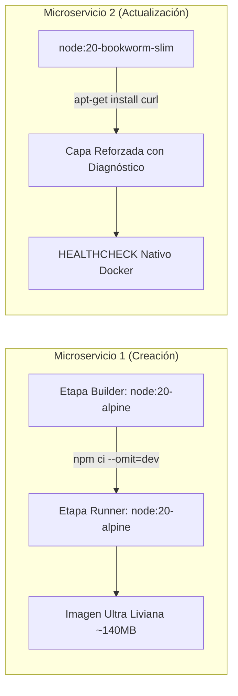

# Documento de Arquitectura y Decisiones de Diseño

> **Asignatura:** Ingeniería DevOps (DOY0101) &bull; Duoc UC  
> **Evaluación:** Evaluación Parcial N°2 &bull; Indicadores: IE1, IE3, IE5

---

## 🏛️ 1. Patrones Arquitectónicos Aplicados

La solución fue diseñada siguiendo principios de **Arquitectura Cloud Native** y **Microservicios Desacoplados**:

### 1.1 Separación de Responsabilidades (Single Responsibility Principle)
En lugar de una aplicación monolítica, el dominio de gestión de productos se fragmentó en dos servicios independientes:
- **`microservicio-creacion`:** Propietario del almacén de datos (lista en memoria) y responsable del ciclo de vida de creación y lectura de productos (**Mouse**, **Teclado**, **Monitor**).
- **`microservicio-actualizacion`:** Encargado de la lógica de negocio asociada a mutaciones de información, reglas de validación tarifaria y persistencia de registros de auditoría.

### 1.2 Patrón BFF (Backend For Frontend)
El componente `frontend` expone una interfaz visual responsiva y actúa simultáneamente como un BFF ligero en Node.js Express. Enruta peticiones hacia los microservicios internos mediante `/api/proxy/creacion` y `/api/proxy/actualizacion`, resolviendo problemas de CORS en navegadores y permitiendo una comunicación transparente tanto en entornos Docker como en ejecución local.

---

## 🐳 2. Estrategia de Contenerización Diferenciada (IE1)

Para satisfacer el requerimiento **IE1** (*"Crear dos Dockerfile para contenerizar dos microservicio libre elección y distinto uno del otro"*), se implementaron dos filosofías de empaquetado:

### Justificación Técnica:
1. **Dockerfile 1 (Alpine Multi-Stage):**
   - Utiliza la biblioteca estándar `musl libc`, logrando una reducción drástica del tamaño de la imagen final.
   - La separación de etapas descarta herramientas temporales y dependencias no productivas.
   - Ejecuta bajo usuario `node` (UID 1000) sin acceso a root.
2. **Dockerfile 2 (Debian Slim Hardened):**
   - Basado en Debian `glibc`, ofreciendo máxima compatibilidad con librerías nativas y herramientas de sistema.
   - Instala explícitamente `curl` para dotar al contenedor de capacidades de introspección y soporte nativo de la directiva `HEALTHCHECK` del Docker Engine.

---

## ⚙️ 3. Orquestación y Gobernanza con Docker Compose (IE5 & IE3)

El archivo `docker-compose.yml` centraliza la topología de la aplicación:

### 3.1 Red Aislada (Network Isolation)
Todos los servicios se comunican a través de la red personalizada `devops-microservicios-net` de tipo `bridge`. Los contenedores se descubren mediante sus nombres de servicio DNS internos (`service-create`, `service-update`, `frontend`).

### 3.2 Gobernanza y Límites de Recursos (IE3)
Para prevenir el agotamiento de recursos en el host (ataques DoS o fugas de memoria), se configuraron límites estrictos de escalabilidad vertical:
- **Límite de CPU:** `0.50` (50% de un núcleo de procesador por servicio).
- **Límite de Memoria RAM:** `256 MB` por contenedor.
- **Reserva de Memoria:** `64 MB` garantizados para arranque.

### 3.3 Políticas de Resiliencia y Dependencias Condicionales
- **Reinicio automático:** `restart: unless-stopped`.
- **Condición de inicio (`depends_on`):** El microservicio de actualización y el frontend esperan a que el microservicio de creación reporte estado `healthy` mediante su comprobación de salud antes de admitir tráfico de red.
