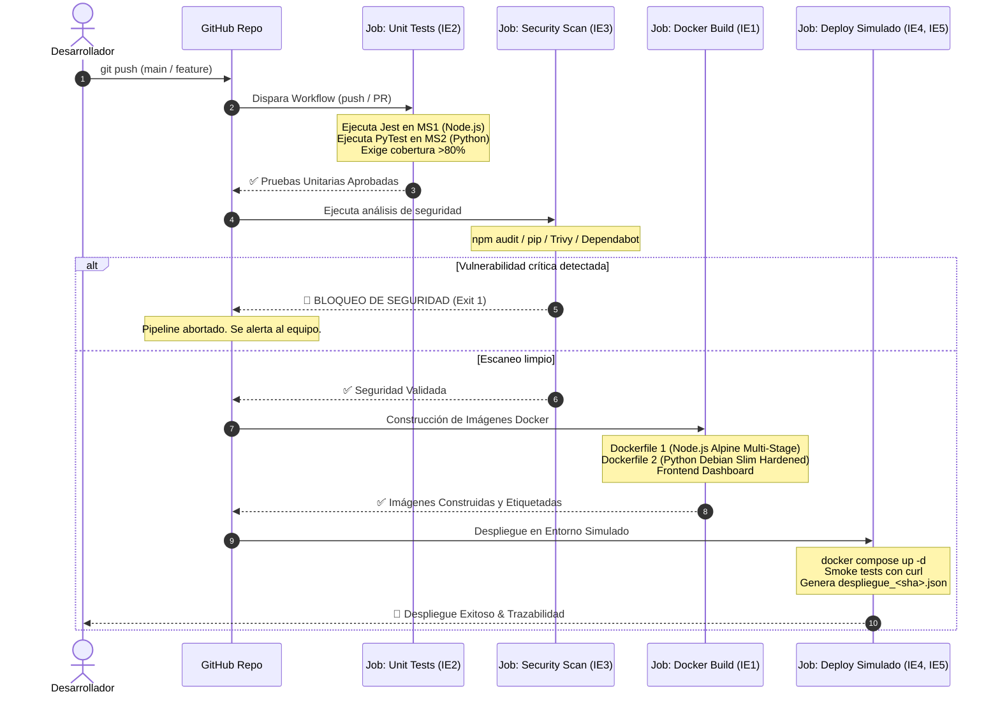

# Documentación del Pipeline CI/CD en GitHub Actions

> **Asignatura:** Ingeniería DevOps (DOY0101) &bull; Duoc UC  
> **Evaluación:** Parcial N°2 &bull; Indicadores: IE1, IE2, IE3, IE4, IE5

---

## 🎯 Objetivo del Pipeline

El objetivo de este pipeline de Integración Continua y Entrega Continua (**CI/CD**) es automatizar íntegramente el ciclo de vida del software, asegurando que cada cambio incorporado en el repositorio sea validado mediante pruebas unitarias rigurosas, analizado contra vulnerabilidades de seguridad, empaquetado en contenedores inmutables y desplegado automáticamente en un entorno de pruebas simulado, garantizando trazabilidad de extremo a extremo.

---

## 🔄 Diagrama de Flujo del Pipeline

---

## 🛠️ Detalle de los Jobs y Etapas

### 1. Etapa de Pruebas Unitarias y Cobertura (`unit-tests` - IE2)
- **Ejecutor:** `ubuntu-latest`
- **Runtimes:**
  - Node.js v20 con caché de dependencias (`actions/setup-node@v4`).
  - Python 3.12 con caché de pip (`actions/setup-python@v5`).
- **Frameworks de Pruebas:**
  - **Jest & Supertest:** En `microservicio-creacion` (14 pruebas).
  - **PyTest & Flask Test Client:** En `microservicio-actualizacion` (21 pruebas, cumpliendo con JaCoCo / PyTest de la rúbrica).
- **Acciones ejecutadas:**
  - Instalación limpia con `npm ci` y `pip install -r requirements.txt`.
  - Generación de reportes de cobertura en formatos LCOV, HTML y consola.
  - Almacenamiento de artefactos de cobertura con retención de 14 días vía `actions/upload-artifact@v4`.

---

### 2. Etapa de Análisis de Seguridad y Bloqueo (`security-analysis` - IE3)
- **Dependencia:** Requiere la aprobación previa del job `unit-tests`.
- **Estrategia SCA (Software Composition Analysis):**
  - Ejecución de `npm audit --audit-level=high` en `microservicio-creacion` y en `frontend`.
  - Análisis estático de vulnerabilidades en el sistema de archivos completo con **Aqua Security Trivy**.
- **Mecanismo de Alerta y Bloqueo (Quality Gate):**
  - Si se detecta cualquier vulnerabilidad clasificada como `HIGH` o `CRITICAL`, el pipeline interrumpe su ejecución con código de salida `1` (`exit 1`).
  - Emite una anotación oficial en GitHub (`::error title=BLOQUEO DE SEGURIDAD::...`) detallando la regla de gobernanza infringida para impedir que código inseguro llegue a producción.

---

### 3. Etapa de Construcción Docker (`docker-build` - IE1)
- **Dependencia:** Requiere la aprobación de `unit-tests` y `security-analysis`.
- **Motor:** Docker Buildx con backend de caché de GitHub Actions (`type=gha`).
- **Imágenes generadas:**
  1. `microservicio-creacion:${{ github.sha }}` y `latest`: Construida mediante la estrategia **Multi-Stage** sobre `node:20-alpine`.
  2. `microservicio-actualizacion:${{ github.sha }}` y `latest`: Construida mediante **Hardened Container** sobre `python:3.12-slim`.
  3. `frontend-dashboard:${{ github.sha }}` y `latest`: Capa de presentación web.
- **Trazabilidad:** Cada imagen es etiquetada unívocamente con el commit SHA de Git para asegurar inmutabilidad y auditoría.

---

### 4. Etapa de Despliegue Simulado y Trazabilidad (`deploy-simulation` - IE4, IE5)
- **Dependencia:** Requiere la finalización exitosa de `docker-build`.
- **Orquestador:** **Docker Compose** en el Runner CI (`docker compose -f docker-compose.yml up -d --build`).
- **Verificación en Ejecución (Smoke Tests):**
  - Espera de estabilización y healthcheck de los servicios.
  - Ejecución de peticiones `curl` con reintentos exponenciales hacia:
    - `http://localhost:3001/health` (Microservicio 1 - Node.js).
    - `http://localhost:3002/health` (Microservicio 2 - Python).
    - `http://localhost:3000/health` (Frontend Dashboard).
    - Consulta funcional al catálogo de productos (`http://localhost:3001/api/productos`).
- **Generación del Manifiesto de Trazabilidad:**
  - Crea el archivo `.trazabilidad/despliegue_${{ github.sha }}.json` conteniendo commit SHA, rama, autor, timestamp y detalle de servicios.
  - Publica el manifiesto como artefacto descargable en GitHub Actions.
- **Limpieza (Teardown):** Ejecución de `docker compose down` al finalizar.

---

## 🤖 Monitoreo Continuo con Dependabot (IE3)

El archivo `.github/dependabot.yml` se encuentra configurado para supervisar semanalmente:
1. Las dependencias `npm` de `microservicio-creacion`.
2. Las dependencias `pip` de `microservicio-actualizacion` (Python).
3. Las dependencias `npm` de `frontend`.
4. Las versiones de las acciones empleadas en GitHub Actions (`actions/checkout`, `actions/setup-node`, `actions/setup-python`, etc.).

Ante cualquier parche de seguridad publicado por los fabricantes, Dependabot generará automáticamente un Pull Request con el análisis de compatibilidad respectivo.
