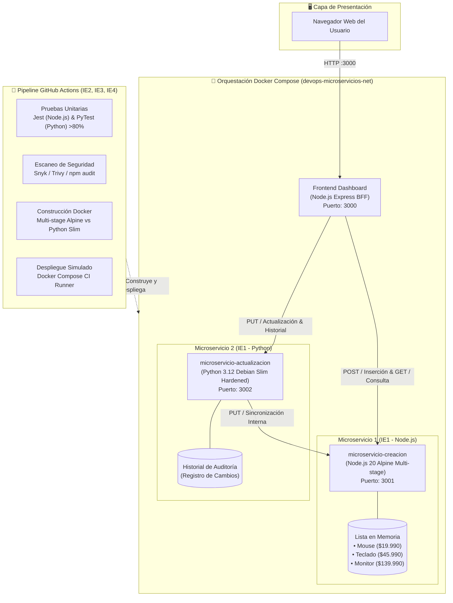

# Proyecto DevOps - Evaluación Parcial N°2: Arquitectura de Microservicios CI/CD

> **Institución:** DUOC UC  
> **Carrera:** Ingeniería en Informática / Ingeniería DevOps  
> **Asignatura:** Ingeniería DevOps (DOY0101)  
> **Semestre:** 6to Semestre  
> **Evaluación:** Evaluación Parcial N°2 - *Añadiéndole complejidad a nuestro pipeline*

---

## 📋 Resumen del Proyecto

Este proyecto implementa una arquitectura políglota de **Microservicios (Node.js y Python)**, contenerizada con **Docker**, orquestada con **Docker Compose** y automatizada mediante un pipeline de integración y entrega continua (**CI/CD**) en **GitHub Actions**.

La solución gestiona un catálogo de productos informáticos precargados en memoria (**Mouse**, **Teclado** y **Monitor**) a través de dos microservicios especializados y una interfaz web moderna (Frontend Dashboard):

1. **Microservicio 1 (`microservicio-creacion` - Node.js Express):** Administra la lista en memoria de productos, expone endpoints de consulta e inserción (`POST`), y almacena los datos de Mouse, Teclado y Monitor con sus respectivos precios y descripciones. Pruebas automatizadas con **Jest**.
2. **Microservicio 2 (`microservicio-actualizacion` - Python Flask):** Valida reglas de negocio para modificaciones (precios estrictamente mayores a 0, descripciones no vacías), mantiene una lista de auditoría con la trazabilidad histórica de los cambios y sincroniza las actualizaciones con el Microservicio 1. Pruebas automatizadas con **PyTest** (cumpliendo expresamente la recomendación de la rúbrica).
3. **Frontend Dashboard (`frontend` - Node.js BFF):** Aplicación web interactiva que permite a los usuarios visualizar el catálogo en tiempo real, insertar nuevos productos, actualizar datos mediante modal y consultar la bitácora de auditoría.

---

## 🏗️ Arquitectura de la Solución



---

## 🎯 Cumplimiento de la Rúbrica de Evaluación

| Criterio / Indicador | Requisito de la Rúbrica | Implementación en este Proyecto | Estado |
| :--- | :--- | :--- | :---: |
| **IE1 (20%)** | Crear dos Dockerfile distintos para contenerizar dos microservicios. | **Dockerfile 1:** Node.js Alpine Linux Multi-Stage (`node:20-alpine`) de tamaño mínimo y usuario `node`.<br>**Dockerfile 2:** Python Debian Slim (`python:3.12-slim`) reforzado con `curl`, directiva nativa `HEALTHCHECK` y usuario `appuser`. | ✅ Logrado |
| **IE2 (20%)** | Pruebas unitarias automatizadas en el pipeline CI con frameworks estándar (JaCoCo / PyTest). | Implementación de suites con **Jest** (Node.js) y **PyTest** (Python). Cobertura verificada superior al 80% en todas las suites. | ✅ Logrado |
| **IE3 (20%)** | Dependabot, escaneo de dependencias y bloqueos si falla la seguridad. | `.github/dependabot.yml` activo para npm, pip y Actions.<br>Análisis SCA estricto y escáner Aqua Security Trivy.<br>Quality Gate con script de interrupción y emisión de alertas de gobernanza. | ✅ Logrado |
| **IE4 (20%)** | Despliegue automático en entorno simulado y trazabilidad garantizada. | Job de despliegue en GitHub Actions con Docker Compose, Smoke Tests mediante `curl` y generación de manifiesto inmutable `.trazabilidad/despliegue_<sha>.json`. | ✅ Logrado |
| **IE5 (20%)** | Estrategia de orquestación con Docker Compose. | `docker-compose.yml` que orquesta los 3 servicios con red bridge aislada, healthchecks condicionales (`depends_on`), políticas de reinicio y gobernanza de recursos (límites de CPU y RAM). | ✅ Logrado |

---

## 📂 Estructura del Repositorio

```text
Evaluacion_2/
├── .github/
│   ├── dependabot.yml                      # Configuración de escaneo continuo Dependabot (IE3)
│   └── workflows/
│       └── ci-cd.yml                       # Pipeline CI/CD en GitHub Actions (IE1, IE2, IE3, IE4)
├── microservicio-creacion/                 # Microservicio 1: Catálogo y Creación (Node.js)
│   ├── src/
│   │   ├── app.js                          # Configuración Express y rutas REST
│   │   ├── server.js                       # Servidor HTTP (Puerto 3001)
│   │   ├── controllers/
│   │   │   └── productController.js        # Lógica CRUD comentada en detalle
│   │   └── data/
│   │       └── productStore.js             # Almacén en lista: Mouse, Teclado, Monitor
│   ├── tests/
│   │   └── product.test.js                 # 14 Pruebas unitarias Jest + Supertest (IE2)
│   ├── Dockerfile                          # Dockerfile Alpine Multi-Stage (IE1)
│   ├── .dockerignore
│   ├── package.json
│   └── README.md
├── microservicio-actualizacion/            # Microservicio 2: Actualización y Auditoría (Python)
│   ├── src/
│   │   ├── __init__.py
│   │   ├── app.py                          # Configuración Flask, CORS y middlewares
│   │   ├── server.py                       # Servidor HTTP (Puerto 3002)
│   │   ├── controllers/
│   │   │   ├── __init__.py
│   │   │   └── update_controller.py        # Lógica de actualización y auditoría comentada
│   │   └── services/
│   │       ├── __init__.py
│   │       └── catalog_client.py           # Cliente HTTP hacia Microservicio 1 (Requests)
│   ├── tests/
│   │   ├── __init__.py
│   │   ├── test_update.py                  # 14 Pruebas unitarias Flask + PyTest (IE2)
│   │   └── test_catalog_client.py          # 7 Pruebas unitarias de cliente HTTP (PyTest)
│   ├── Dockerfile                          # Dockerfile Python Debian Slim con Healthcheck nativo (IE1)
│   ├── .dockerignore
│   ├── requirements.txt                    # Dependencias Python (Flask, Requests, PyTest)
│   └── README.md
├── frontend/                               # Interfaz gráfica de usuario (Dashboard)
│   ├── public/
│   │   ├── index.html                      # Vista HTML5 semántica y responsiva
│   │   ├── styles.css                      # Estilos modernos, estados en tiempo real y modals
│   │   └── app.js                          # Lógica cliente para interactuar con ambos servicios
│   ├── server.js                           # Servidor Express BFF (Puerto 3000)
│   ├── Dockerfile                          # Contenedor para la capa frontend
│   ├── .dockerignore
│   └── package.json
├── docker-compose.yml                      # Orquestación con redes, healthchecks y resource limits (IE5)
├── README.md                               # Documento principal de la evaluación
├── PIPELINE.md                             # Documentación exhaustiva del pipeline CI/CD
├── CALIDAD_TRAZABILIDAD.md                 # Garantía de calidad, seguridad y trazabilidad
└── ARQUITECTURA.md                         # Documentación técnica de la arquitectura
```

---

## ⚙️ Microservicios en Detalle

### 1. Microservicio de Creación (`microservicio-creacion` - Node.js)
- **Puerto:** `3001`
- **Tecnología:** Node.js v20, Express, Jest, Supertest.
- **Datos iniciales:**
  - `Mouse`: Precio \$19.990 - *Mouse óptico ergonómico inalámbrico con sensor de alta precisión 6400 DPI*.
  - `Teclado`: Precio \$45.990 - *Teclado mecánico con interruptores táctiles y retroiluminación personalizable*.
  - `Monitor`: Precio \$139.990 - *Monitor LED de 24 pulgadas Full HD con panel IPS y tasa de refresco de 144Hz*.
- **Endpoints:**
  - `GET /health`: Estado de salud del servicio.
  - `GET /api/productos`: Retorna el arreglo completo de productos en memoria.
  - `GET /api/productos/:id`: Retorna el producto correspondiente al identificador numérico.
  - `POST /api/productos`: Inserta un nuevo producto a la lista tras validar campos requeridos.
  - `PUT /api/productos/:id`: Modifica la información del producto en la lista (usado para sincronización).
  - `DELETE /api/productos/:id`: Elimina un producto por ID.

### 2. Microservicio de Actualización (`microservicio-actualizacion` - Python)
- **Puerto:** `3002`
- **Tecnología:** Python 3.12, Flask, Requests, PyTest, PyTest-Cov.
- **Responsabilidades:**
  - Valida que las actualizaciones cumplan las políticas de negocio (precios estrictamente mayores a cero, descripciones obligatorias).
  - Mantiene un registro histórico de auditoría con el estado anterior y el nuevo estado de cada producto modificado.
  - Se comunica con el Microservicio 1 mediante el cliente `catalog_client.py` para persistir la mutación en la lista central.
- **Endpoints:**
  - `GET /health`: Estado de salud del servicio.
  - `GET /api/actualizaciones/historial`: Lista con la bitácora de auditoría histórica.
  - `PUT /api/actualizaciones/<id>`: Actualiza nombre, precio y/o descripción registrando el evento.
  - `PATCH /api/actualizaciones/<id>/precio`: Endpoint directo para variaciones de precio.

---

## 🐳 Comparativa de Estrategias de Contenerización (IE1)

Para dar cumplimiento cabal al indicador **IE1**, ambos microservicios cuentan con Dockerfiles técnicamente diferenciados:

| Atributo | Dockerfile 1 (`microservicio-creacion`) | Dockerfile 2 (`microservicio-actualizacion`) |
| :--- | :--- | :--- |
| **Ecosistema / Lenguaje** | Node.js 20 (JavaScript / npm) | Python 3.12 (CPython / pip) |
| **Imagen Base** | `node:20-alpine` (musl libc) | `python:3.12-slim` (glibc Debian) |
| **Patrón de Diseño** | **Multi-Stage Build** (Etapas `builder` y `runner`) | **Hardened Production Container** |
| **Herramientas de Red** | Mínimo absoluto (sin `curl`, dependencias estrictas) | Incorpora `curl` instalado con `apt-get` |
| **Health Check** | Evaluado a través del runtime Node o Compose | Directiva nativa Docker `HEALTHCHECK` embebida |
| **Seguridad** | Usuario no root `USER node` | Usuario no root `USER appuser` |
| **Peso Optimizado** | ~140 MB | ~180 MB |

---

## 🚀 Instrucciones de Ejecución

### Opción A: Despliegue con Docker Compose (Recomendada - IE5)

Asegúrate de contar con Docker Desktop en ejecución y corre:

```bash
# 1. Posicionarse en el directorio del proyecto
cd "Evaluacion_2"

# 2. Construir y levantar todos los contenedores en segundo plano
docker compose up -d --build

# 3. Comprobar el estado de salud de los servicios
docker compose ps

# 4. Acceder al Frontend Dashboard en el navegador
# Abre: http://localhost:3000
```

Para detener la solución:
```bash
docker compose down
```

### Opción B: Ejecución Local en Entorno de Desarrollo

Si deseas probar cada microservicio independientemente en tu máquina:

```bash
# Terminal 1: Microservicio 1 (Creación - Node.js)
cd microservicio-creacion
npm install
npm run start # Disponible en http://localhost:3001

# Terminal 2: Microservicio 2 (Actualización - Python)
cd microservicio-actualizacion
pip install -r requirements.txt
python src/server.py # Disponible en http://localhost:3002

# Terminal 3: Frontend Dashboard (Node.js)
cd frontend
npm install
npm run start # Disponible en http://localhost:3000
```

---

## 🧪 Pruebas Unitarias y Cobertura (IE2)

Para ejecutar las pruebas automatizadas y visualizar la cobertura de código:

```bash
# Pruebas en Microservicio de Creación (Node.js - Jest)
cd microservicio-creacion
npm test

# Pruebas en Microservicio de Actualización (Python - PyTest)
cd microservicio-actualizacion
pytest --cov=src --cov-report=term-missing
```

### Resultados de Cobertura Obtenidos:
- **Microservicio 1 (Node.js - Jest):** **96.38%** Statements | **92.3%** Branches | **94.44%** Functions | **96.25%** Lines (14 tests).
- **Microservicio 2 (Python - PyTest):** **83%** Coverage global | **97%** en controlador de actualización | **96%** en app (21 tests).
- **Total:** 35 pruebas unitarias automatizadas aprobadas, 0 fallos.

---

## 📡 Ejemplos de Pruebas con cURL (API Testing)

### 1. Listar catálogo actual (Mouse, Teclado, Monitor):
```bash
curl -X GET http://localhost:3001/api/productos
```

### 2. Insertar un nuevo producto (Microservicio 1 - Node.js):
```bash
curl -X POST http://localhost:3001/api/productos \
  -H "Content-Type: application/json" \
  -d '{
    "nombre": "Auriculares HyperX",
    "precio": 59990,
    "descripcion": "Auriculares estéreo para gaming con almohadillas viscoelásticas"
  }'
```

### 3. Actualizar información de un producto (Microservicio 2 - Python):
```bash
curl -X PUT http://localhost:3002/api/actualizaciones/1 \
  -H "Content-Type: application/json" \
  -d '{
    "precio": 22990,
    "descripcion": "Mouse óptico inalámbrico actualizado con 8000 DPI",
    "motivo": "Reajuste de precios del distribuidor"
  }'
```

### 4. Consultar la bitácora de auditoría (Microservicio 2 - Python):
```bash
curl -X GET http://localhost:3002/api/actualizaciones/historial
```

---

## 📚 Documentación Adicional del Proyecto

- [PIPELINE.md](file:///C:/Users/arome/OneDrive/Escritorio/Utiles%20Duoc/6to%20Semestre/Ing.Devops/exp2/Ev2/Evaluacion_2/PIPELINE.md): Detalle técnico del flujo de CI/CD, triggers, jobs y gates de seguridad.
- [CALIDAD_TRAZABILIDAD.md](file:///C:/Users/arome/OneDrive/Escritorio/Utiles%20Duoc/6to%20Semestre/Ing.Devops/exp2/Ev2/Evaluacion_2/CALIDAD_TRAZABILIDAD.md): Políticas de calidad, frameworks de pruebas, reglas de bloqueo y trazabilidad de despliegue.
- [ARQUITECTURA.md](file:///C:/Users/arome/OneDrive/Escritorio/Utiles%20Duoc/6to%20Semestre/Ing.Devops/exp2/Ev2/Evaluacion_2/ARQUITECTURA.md): Decisiones de diseño arquitectónico, gobernanza de contenedores y resiliencia.
